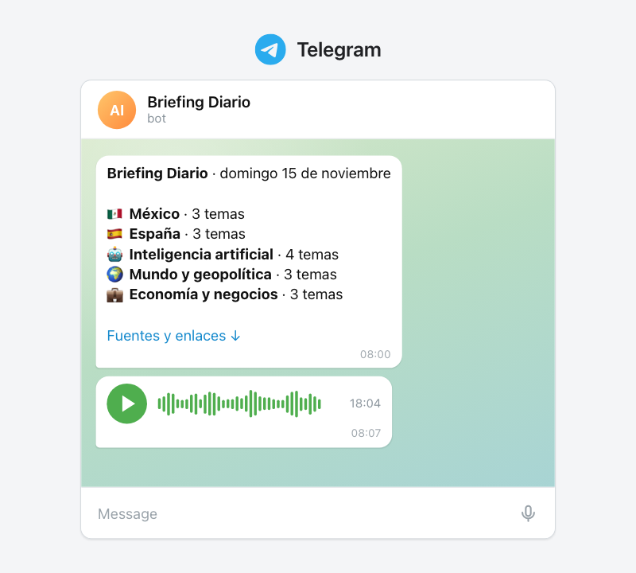
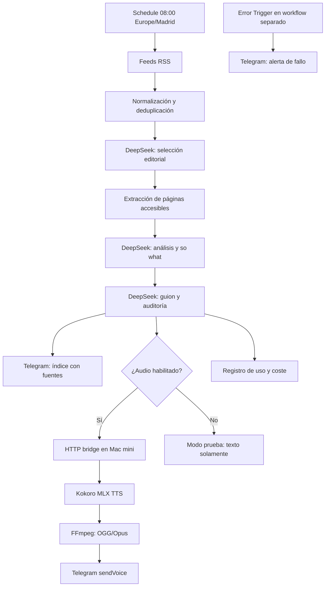

# AI News Podcast | n8n + DeepSeek + Kokoro + Telegram



<sub>Illustrative mock-up of the daily delivery: an index message with the five sections, then the voice note. Telegram is a trademark of its owner.</sub>

> **Self-hosted AI news intelligence pipeline** that curates, analyzes, scripts, and narrates daily news covering Mexico, Spain, AI, geopolitics, and business.

**Estado / Status:** implemented and iteratively tested on a Mac mini M1. Reliability hardening and verification of fully unattended voice delivery are ongoing. This repository is an engineering record and reusable starting point, **not a promise of uninterrupted service**.

## Resumen

Este proyecto convierte cientos de titulares y extractos RSS en un briefing de audio en español con cinco secciones y análisis de consecuencias (*so what?*). Diseñado como un único workflow editorial de **n8n** con un workflow adicional independiente para alertas de error. El análisis se ejecuta mediante **DeepSeek**, mientras que **Kokoro** sintetiza la voz localmente en un **Mac mini M1** y **Telegram** distribuye el episodio.

**Why I built it:** To move from news aggregation toward decision-useful intelligence: select the important events, explain context, assess implications, and communicate findings in a daily audio format.

### Qué hace

- **Sourcing:** ingiere feeds RSS de México, España, IA, mundo y economía; configuración de referencia con hasta 35 feeds, sujetos a disponibilidad y validación individual.
- **Selección:** agrupa noticias repetidas y aplica criterios editoriales de impacto, novedad y relevancia.
- **Análisis:** produce fichas con hechos, contexto, incertidumbres y *so what*; no debe presentar afirmaciones sin respaldo como hechos.
- **Narración:** crea un guion diario en español (objetivo editorial: aproximadamente 18 minutos).
- **Audio:** genera voz local con Kokoro TTS (Apple Silicon) y la convierte a OGG/Opus con FFmpeg.
- **Entrega:** envía índice, fuentes y nota de voz a Telegram.
- **Observabilidad:** incluye registro de tokens y un workflow separado de alertas cuando falla la ejecución.

## Arquitectura



**Entorno:** n8n dentro de Docker Desktop, Kokoro en macOS (MLX) y bridge HTTP accesible desde el contenedor mediante `host.docker.internal`.

## Repositorio

```text
workflows/
  podcast-daily.json       # Workflow principal (35 nodos, 35 feeds RSS)
  error-alerts.json        # Workflow independiente de alertas de error (6 nodos)
scripts/
  kokoro_bridge.py         # Servicio local Kokoro → FFmpeg → Telegram
  sanitize_n8n_export.py   # Ayuda a limpiar exportaciones antes de publicar
docs/
  architecture.md
  engineering-decisions.md
  setup.md
  security-checklist.md
  project-journey.md
.env.example
.gitignore
```

> **Sobre los workflows:** son exportaciones del n8n en uso (15 nov 2026), pasadas por `scripts/sanitize_n8n_export.py` y escaneadas en busca de credenciales, Chat IDs, tokens, correos y datos pinneados. Se importan **inactivos**; configura tus credenciales y el nodo `CONFIG` antes de activarlos.

## Instalación / Reproduction

Consultar [docs/setup.md](docs/setup.md) para dependencias, exportación/importación de workflows, credenciales y conexión Docker↔macOS. Todos los secretos se configuran fuera del repositorio. **Nunca subas tu `.env`, Chat ID real, token de Telegram o claves de DeepSeek.**

## Diseño editorial

| Sección | Enfoque |
| --- | --- |
| México | Política pública, negocios y acontecimientos de relevancia nacional |
| España | Economía, sociedad y decisiones de impacto nacional |
| Inteligencia artificial | Modelos, adopción, competencia, chips y regulación |
| Mundo y geopolítica | Conflictos, diplomacia, comercio y cambios estructurales |
| Economía y negocios | Mercados, empresas, indicadores macroeconómicos |

Fuentes prestigiosas, verificables y preferentemente abiertas. Algunos RSS (como WSJ o The Economist) se utilizan como señales de descubrimiento; un titular de un medio con paywall **no debe tratarse como verificación de un artículo completo**.

## Decisiones y lecciones

- Calidad editorial por encima de minimizar tokens, sin renunciar a registrar el coste.
- Extracción y deduplicación por reglas antes del análisis con LLM.
- Revisión editorial y distinción explícita entre hechos, análisis y escenarios.
- Generación de voz local, desacoplada del workflow mediante un bridge HTTP.
- Un solo workflow principal, más una automatización independiente para incidentes.
- Validar la respuesta real del proveedor: un nodo HTTP verde no garantiza contenido útil.

Más detalles en [engineering decisions](docs/engineering-decisions.md) y [project journey](docs/project-journey.md).

## Límites conocidos

- Los feeds cambian y algunos artículos están restringidos por paywall.
- La calidad del análisis depende de la cobertura, extracción y disponibilidad real de fuentes.
- La latencia y los costes de DeepSeek pueden variar según modelo y volumen diario.
- La entrega de voz requiere que macOS, Kokoro, el bridge y Telegram estén disponibles.
- Los procesos de recuperación automática y pruebas de extremo a extremo necesitan validarse con la exportación viva.

## Créditos

Inspirado conceptualmente en [sebagarciar/kindle-news-filter](https://github.com/sebagarciar/kindle-news-filter). Este proyecto adapta el problema de curación diaria a análisis narrativo y voz por Telegram; no se reivindica autoría del repositorio original ni se distribuyen sus archivos aquí.

## License

MIT ([LICENSE](LICENSE)). Este proyecto no incluye código de terceros; la inspiración conceptual en `kindle-news-filter` está citada en Créditos.

---

<sub>Parte de [AI Build Log](https://github.com/julianreves/ai-build-log) · por [Julián Revorio](https://www.linkedin.com/in/julianrevorio/)</sub>
